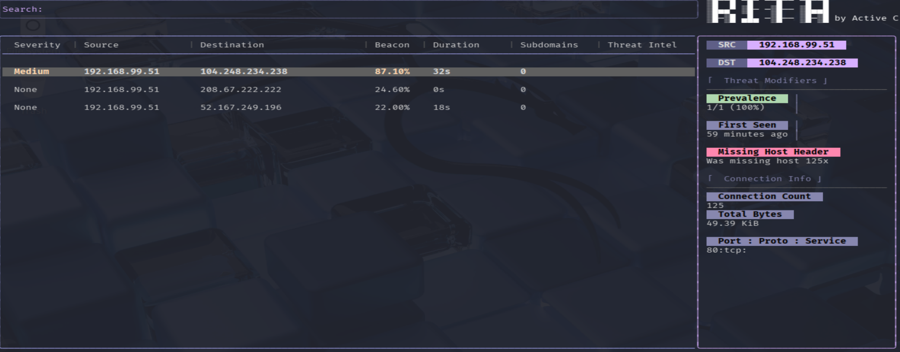
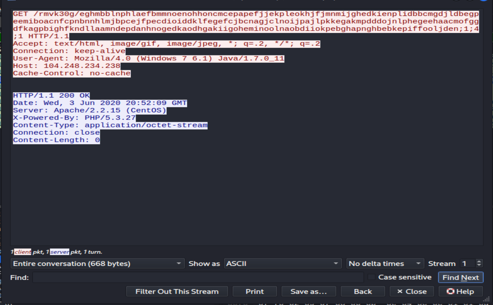

# Fiesta Exploit Kit - Cobalt Strike C2 Analysis

## Objective
While threat intel indicates the initial delivery was a PowerShell one-liner, this pcap captures the post-infection phase. The analysis focuses on the active Cobalt Strike beaconing to the C2 server. The goal is to detect automated command-and-control (C2) check-ins, extract the indicators of compromise (IOCs), and document the traffic pattern using Zeek, RITA, and Wireshark.

## Lab Environment

**Victim Host**
- IP: 192.168.99.51
- OS: Windows 10 x64

**C2 Server**
- IP: 104.248.234.238
- Server Header: Apache/2.2.15 (CentOS)
- *Note:* The pcap captures only the post-infection phase, so the server's true OS cannot be verified from the traffic alone. However, lab intel states it is Ubuntu 18.04.3, while Wireshark shows a CentOS header. This discrepancy indicates the attacker spoofed the banner.

**Analysis Box (Kali Linux)**
- Tools: Zeek 7.0.8, RITA 5.1.2, Wireshark 4.6.6
- Traffic Type: Reverse HTTP
- C2 Platform: Cobalt Strike (Confirmed by Malleable C2 profile in lab intel)

## Phase 1: Initial Detection

Zeek was used to parse the pcap into structured logs. Those logs were then imported into RITA to analyze connection timings and look for automated beaconing.

RITA flagged a high-severity beacon from the victim (`192.168.99.51`) to the C2 server (`104.248.234.238`) with an **87.10% beacon score**. The connection duration was 32 seconds, which aligns with the 30-second check-in time with 10% jitter.

RITA also noted the connection was missing a Host Header 125 times, which is a common sign of malware communicating directly to an IP address over HTTP.

## Phase 2: Investigation

To confirm the C2 traffic, the pcap was opened in Wireshark. A display filter was applied to isolate traffic to the C2 IP: `ip.addr == 104.248.234.238`.

The traffic showed a repeating pattern of HTTP GET requests and 200 OK responses. Following the TCP stream revealed the malware checking in using a long, random URI path (e.g., `/rmvk30g/eghmbb...`).

The HTTP headers confirmed the malware was trying to blend in by using a fake User-Agent string:
`User-Agent: Mozilla/4.0 (Windows 7 6.1) Java/1.7.0_11`

The victim machine is Windows 10, but the malware is pretending to be an older Windows 7 machine. The server replied with `Content-Length: 0`, indicating it had no commands for the victim at that time.

## Indicators of Compromise (IOCs)

| Type | Indicator |
| :--- | :--- |
| IPv4 Address | `104.248.234.238` |
| URI Pattern | `/rmvk30g/` (followed by long random strings) |
| User-Agent | `Mozilla/4.0 (Windows 7 6.1) Java/1.7.0_11` |
| Traffic Pattern | HTTP GET requests every 30s (10% jitter) |

## Remediation & Lessons Learned

**Remediation**
- **Block the IOC:** Add the C2 IP and URI pattern to perimeter firewall and proxy blocklists.
- **Endpoint Isolation:** Isolate the infected Windows 10 host (`192.168.99.51`) from the network.
- **Credential Reset:** Assume all credentials on the infected host are compromised and force a reset.

**Lessons Learned**
- **Beaconing is Predictable:** Automated malware checks in at regular intervals. RITA makes this easy to spot without manually scrolling through thousands of packets.
- **Headers Lie:** Do not trust the User-Agent or Server headers. Malware intentionally spoofs these to look like normal traffic.
- **Jitter:** The malware adds a 10% random delay to its 30-second check-in time. This makes the timing slightly uneven (e.g., 32 seconds instead of exactly 30) to evade simple detection rules. RITA's mathematical scoring still caught the pattern.
