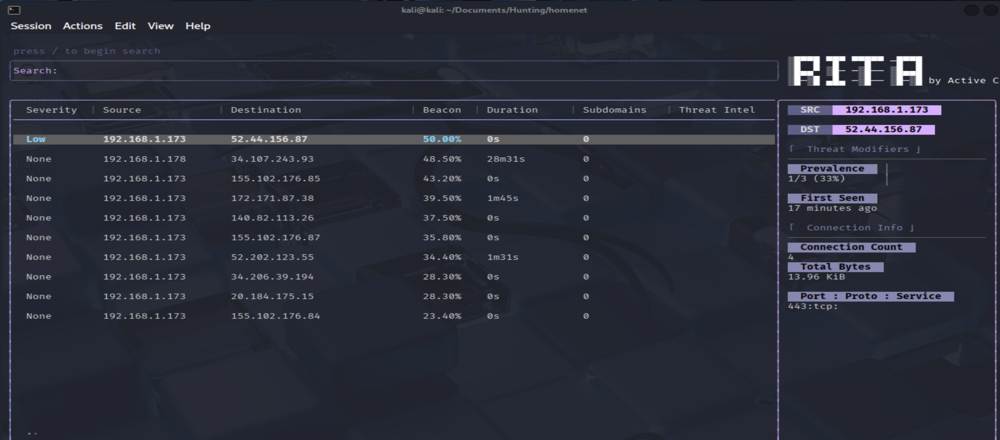
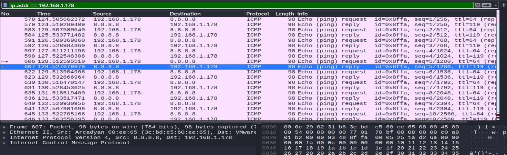

# Home Network Baseline Analysis

## Overview

Analysis of a 1-hour packet capture from a home network, captured from a Kali Linux VM running on a bridged VMware adapter. The goal was to establish what normal traffic looks like on a small network — a baseline to compare against future anomalies — and to inventory the devices visible from a single endpoint.

## Environment

- **Capture size:** 227 MB, 208,045 packets, ~60 minutes
- **Capture date:** October 16, 2026
- **Capture window:** 08:33:41 to 09:33:40 UTC
- **Analysis tools:** Zeek 7.0.8, RITA 5.1.2, Wireshark 4.6.6
- **Platform:** Kali Linux (VMware VM, bridged networking)
- **Local network:** 192.168.1.0/24
- **Capturing host:** 192.168.1.178 (Kali VM)
- **SHA256 (scrubbed pcap):** a8997356b26fae0377ed99b184fe75ddb196a8c702bec24a16ccc7170612ee4d

## Capture Notes

This pcap has been scrubbed before publication. The original capture contained traffic from the Windows host machine running the VM (192.168.1.173), which was visible to the VM due to a VMware bridged-networking behavior. That traffic was removed from the published file to avoid exposing the host's browsing metadata.

The presence of host traffic in a guest VM capture is itself a security-relevant observation and is documented in the Findings section below.

## Findings

### Device inventory from passive capture

Even without actively scanning the network, broadcast traffic reveals what devices are present. ARP requests, SSDP announcements, and mDNS queries are sent to all devices on the local segment, so a passive capture sees them.

Devices observed in the capture include:

- Arcadyan (router or access point)
- CommScope (networking equipment)
- Espressif (IoT device — smart plug, sensor, or similar)
- Nintendo (game console)
- VMware (the Kali VM itself)

Vendor identification comes from the first three bytes of each MAC address (the OUI). This is a standard passive-reconnaissance technique — no traffic is sent to the devices, they simply announce themselves on the broadcast domain.

### Baseline RITA scoring

RITA flagged one pair at a 50% beacon score, severity Low: 192.168.1.173 to 52.44.156.87 with 4 connections, 13.96 KiB transferred on port 443 (HTTPS). This is consistent with a routine background service checking in periodically.

For comparison:

| Metric | Zeus (malware) | PittyTiger (malware) | Home network |
|--------|---------------|----------------------|--------------|
| Top beacon score | 87.5% | 87% | 50% |
| Severity | High | Medium | Low |
| Connections | 2,883 | 133 | 4 |
| Bytes | 639 MB | 46 KB | 14 KB |

A baseline capture establishes what "normal" looks like. An analyst who knows their network's normal pattern can spot deviations faster. In this capture, nothing crossed the threshold from "legitimate background traffic" into "consistent with C2."

### Protocol mix

The capture was dominated by broadcast and multicast protocols — SSDP, mDNS, ICMPv6, and ARP — making up approximately 99% of all packets. These are devices announcing themselves to the network.

Unicast traffic (actual browsing, DNS lookups, TLS sessions) came from the Kali VM (192.168.1.178) and the Windows host (192.168.1.173), totaling about 1,800 packets combined.

DNS queries showed expected destinations: http.kali.org from apt update, www.google.com from a Google login, www.youtube.com and i.ytimg.com from watching a video.

### Host traffic leak (security observation)

During analysis, TLS traffic from 192.168.1.173 (the Windows host machine running the VM) appeared in the pcap. The VM was able to see unicast traffic from a device it should not have been able to observe.

Why this matters:

On a properly isolated switched network, a VM should only see traffic to and from itself, plus broadcast traffic. It should not see unicast traffic between other devices. Host-to-destination traffic (like 192.168.1.173 to 140.82.113.26 for GitHub) is unicast. A VM on the same bridged network should not see it. The fact that it appeared suggests VMware's bridged networking is mirroring some host traffic to the guest's virtual interface.

Impact:

- Guest can observe host activity. Domain names, timing, and traffic patterns from the host's browsing are visible in the guest's capture. TLS encrypts the content, but the metadata (SNI, DNS, timing) is unencrypted.
- Relevant in security-sensitive environments. If a user runs untrusted VMs on their workstation, those VMs may be able to passively monitor host traffic.

This was observed but not fully investigated. A deeper analysis would involve checking the VMware network driver configuration, examining the host's NIC offload settings, and testing whether the behavior persists with different VMware adapter modes (NAT, Host-only, custom).

## Indicators of Compromise

None. This is a baseline capture with no malicious activity. All connections are to legitimate services (Google, YouTube, Kali package mirrors, Microsoft).

## Lessons Learned

1. Baselines are valuable. Establishing what normal looks like is the first step toward detecting abnormal. A SOC analyst who knows their network's normal pattern can spot deviations faster than one who only looks at alerts.

2. Passive reconnaissance works. Device inventory was built from broadcast traffic alone, without sending a single probe. This is useful in situations where active scanning is not possible or not welcome.

3. Network isolation is not always complete. Host traffic appearing in a guest VM capture shows that virtual network boundaries can leak. Anyone running VMs on a production network should verify the actual isolation level.

4. Realistic captures contain noise. This pcap is 99% broadcast noise. Real analyst work involves filtering out that noise to find the signal — which is exactly what the Wireshark filters in this analysis did.
