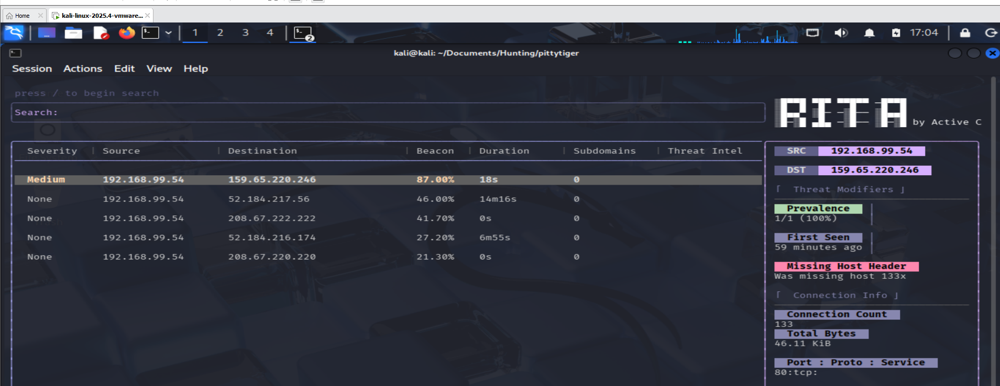
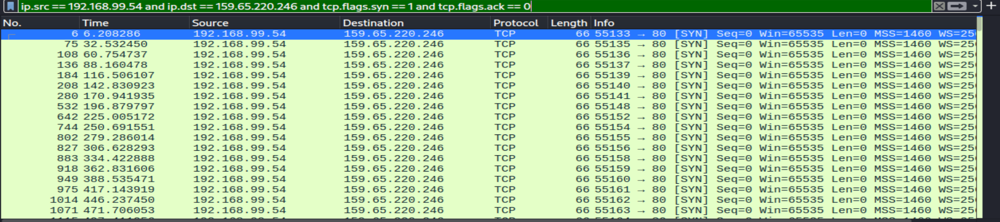
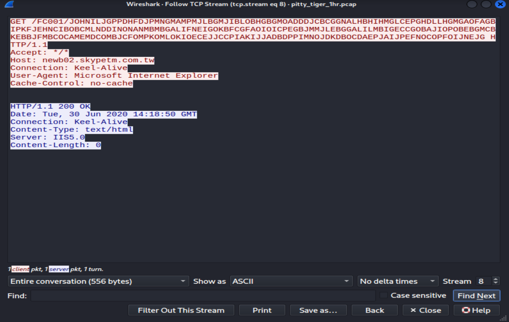

# PittyTiger C2 Investigation

## Overview

Analysis of a 1-hour packet capture from an infected host showing command-and-control (C2) beaconing to a Taiwan domain. PittyTiger is a remote access trojan (RAT) attributed to an APT group.

## Environment

- **Capture size:** 1.03 MB, 6,261 packets, ~60 minutes
- **Capture date:** June 30, 2020
- **Capture window:** 10:17:05 to 11:17:03 UTC
- **Analysis tools:** Zeek 7.0.8, RITA 5.1.2, Wireshark 4.6.6
- **Platform:** Kali Linux
- **SHA256:** b309c1e18649fb593e182df7d73f635bd5e40c0e325914c55fb2a60c75ec9e64

## Initial Detection

RITA flagged the pair 192.168.99.54 to 159.65.220.246 with an 87.00% beacon score, marking it Medium severity. The connection count was 133 over 59 minutes. Total bytes transferred was only 46.11 KiB.

## Investigation

### Confirming the beaconing pattern

Filtering Wireshark to initial SYN packets between the two hosts showed 133 connection attempts over the capture. The intervals between them varied between 24 and 30 seconds, clustering around 27 seconds.

The beacon timing is deliberately jittered. Fixed-interval beacons are easy for simple detectors to spot; PittyTiger applies approximately 20% jitter to avoid this. RITA's 87% score reflects the added irregularity — a perfect fixed interval would score higher.

### Analyzing the beacon structure

Following a single TCP stream revealed the beacon payload:

    GET /FC001/JOHNILJGPPDHFDJPMNGMAMPMJLBGMJIBLOBHBGBMOADDDJCBCGGNALHBHIMGLCEPGHDLLHGMGAOFAGBIPKFJEHNC...
    HTTP/1.1
    Accept: */*
    Host: newb02.skypetm.com.tw
    Connection: Keep-Alive
    User-Agent: Microsoft Internet Explorer
    Cache-Control: no-cache

The URL path contains a long string of uppercase letters rather than a real resource path. This is encoded data being exfiltrated or beaconed to the C2 server, disguised as a URL so it survives inspection that only looks at HTTP headers.

The Host header resolves to newb02.skypetm.com.tw, a .tw (Taiwan) domain. The name resembles a misspelling of "Skype" and does not correspond to any legitimate service. Traffic from a US retail network to a Taiwan domain named like this is anomalous.

The User-Agent string is a plain "Microsoft Internet Explorer" with no version number, no operating system, and no engine information. Real browsers always include these details. This string was written by hand by the malware author and does not match what any real browser sends.

The server response was:

    HTTP/1.1 200 OK
    Date: Tue, 30 Jun 2020 14:18:50 GMT
    Connection: Keep-Alive
    Content-Type: text/html
    Server: IIS5.0
    Content-Length: 0

The server acknowledged the request with a 200 OK but sent no content back. In this exchange, the beacon was one-way — data going to the C2 server without new instructions coming back.

## Indicators of Compromise

| Type | Value |
|------|-------|
| Infected host | 192.168.99.54 |
| C2 IP | 159.65.220.246 |
| C2 domain | newb02.skypetm.com.tw |
| URL prefix | /FC001/ |
| Beacon interval | 24-30 seconds (jittered) |
| User-Agent | Microsoft Internet Explorer |
| Connection count | 133 |
| Capture duration | 59 minutes |

## Recommended Response

1. Isolate 192.168.99.54 from the network
2. Block 159.65.220.246 and newb02.skypetm.com.tw at the perimeter
3. Capture volatile memory before shutdown to preserve in-memory artifacts
4. Hunt for the same beacon interval (24-30s jittered), User-Agent, and /FC001/ URL prefix across other hosts
5. Escalate to incident response — the jitter and the anomalous domain suggest a targeted threat rather than commodity crimeware

## Lessons Learned

PittyTiger demonstrates how malware authors adapt to detection. Jittered beacon timing is a deliberate evasion against detectors tuned for regular intervals. The trade-off is that jitter reduces the malware's own reliability — the operator cannot predict exactly when a victim will check in.

RITA's beacon scoring caught the pattern despite the jitter, scoring it at 87% rather than 100%. This is the value of statistical beacon detection over simple "fires every N seconds" rules. The detection remains effective even when the attacker deliberately introduces variation.

The small beacon size (46.11 KiB total across 133 connections) indicates a persistent channel with minimal data transfer, not bulk payload delivery. This is consistent with an espionage-focused threat rather than financial crimeware.
