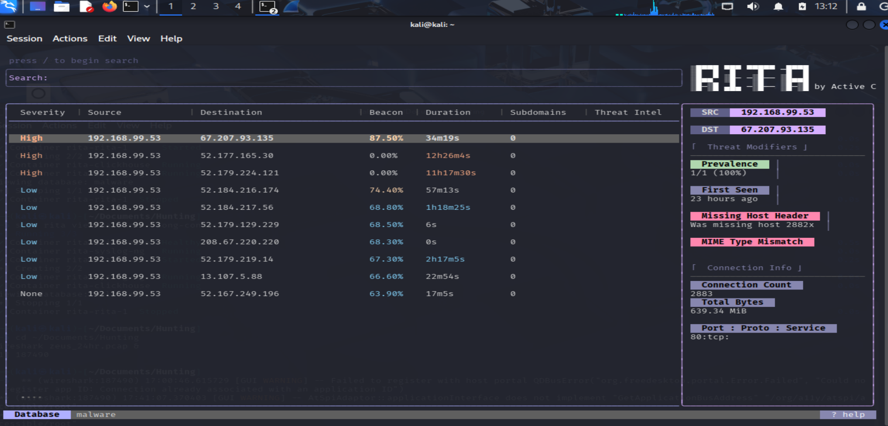
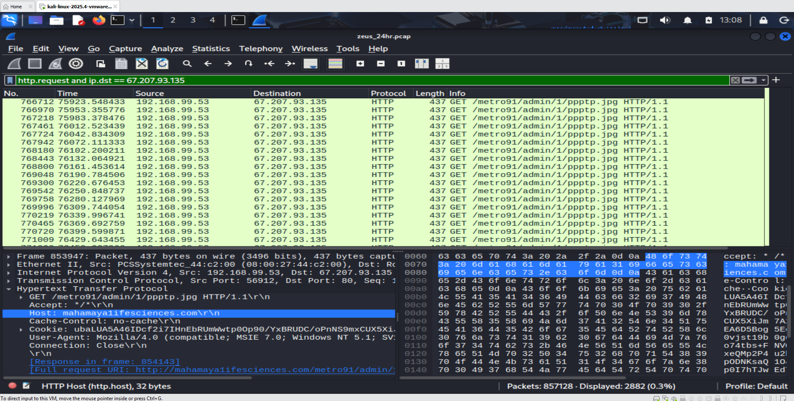
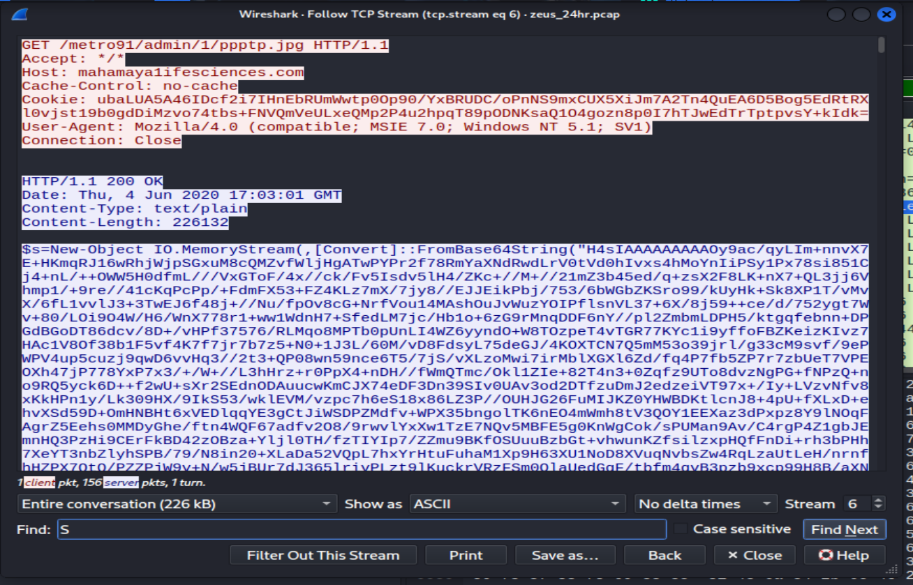

# Zeus C2 Investigation

## Overview

Analysis of a 24-hour packet capture from an infected host showing command-and-control (C2) beaconing and a fileless PowerShell payload delivery.

## Environment

- **Capture size:** 916 MB, 857,128 packets, 24 hours
- **Capture date:** June 4-5, 2020
- **Analysis tools:** Zeek 7.0.8, RITA 5.1.2, Wireshark 4.6.6
- **Platform:** Kali Linux

## Initial Detection

RITA flagged the pair 192.168.99.53 to 67.207.93.135 with an 87.50% beacon score, marking it High severity. The connection count was 2,883 with 639.34 MiB transferred over port 80.

## Investigation

### Confirming the beaconing pattern

Filtering Wireshark to SYN packets between the two hosts showed 2,884 connection attempts spaced approximately 29-30 seconds apart. That is a near-perfect beaconing interval sustained for the full 24-hour capture.

### Analyzing the payload delivery

Following a single TCP stream revealed an HTTP GET request:

The User-Agent string (Internet Explorer 7 on Windows XP) is a strong indicator of automated tooling. It is the default string used by PowerShell when making web requests without an explicit User-Agent set.

The server response was:

    HTTP/1.1 200 OK
    Content-Type: text/plain
    Content-Length: 226132

A file named .jpg being served as text/plain instead of image/jpeg is a content-type mismatch. The file is not what its extension claims.

### Payload analysis

The response body begins with a PowerShell variable declaration and a Base64-decoded memory stream. The starting sequence of the decoded data is H4sIAAAAAAAA, which is the gzip file signature.

The response body ends with the execution line: IEX combined with a GzipStream decompression and a StreamReader that reads the decompressed result to the end.

This is a fileless PowerShell downloader. The steps are:

1. Base64-decode the response body into memory
2. Decompress the result from gzip
3. Execute the decompressed script using IEX (Invoke-Expression)

Nothing is written to disk, which defeats traditional antivirus scanning.

## Indicators of Compromise

| Type | Value |
|------|-------|
| Infected host | 192.168.99.53 |
| C2 IP | 67.207.93.135 |
| C2 domain | mahamaya1ifesciences.com |
| URL path | /metro91/admin/1/ppptp.jpg |
| Beacon interval | 29-30 seconds |
| User-Agent | Mozilla/4.0 (compatible; MSIE 7.0; Windows NT 5.1; SV1) |
| Payload size | 226,132 bytes |

## Recommended Response

1. Isolate 192.168.99.53 from the network
2. Block 67.207.93.135 and mahamaya1ifesciences.com at the perimeter
3. Capture volatile memory before shutdown to preserve in-memory artifacts
4. Hunt for the same beacon pattern and User-Agent across other hosts
5. Escalate to incident response for full forensic analysis

## Lessons Learned

The malware used three common evasion techniques in combination:

- Beaconing disguised as regular web traffic on port 80
- Content-type mismatch to bypass file-extension filtering
- Fileless execution to evade disk-based detection

RITA's beacon scoring detected the traffic pattern without any signature or hash match. That is the value of behavioral detection over signature-based detection.
